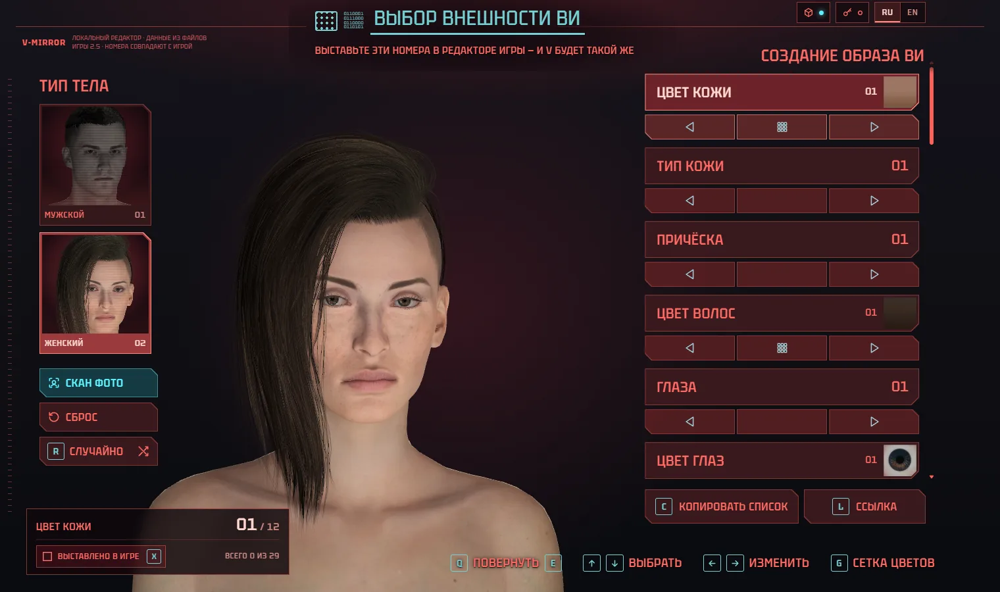

# V-Mirror

**Make your Cyberpunk 2077 V look like a real person.** V-Mirror is a web replica of the
game's character creator (patch 2.5, both body types) that reads a reference photo and tells
you which option to pick in every row: skin, hairstyle and colour, eyes, nose, mouth, jaw,
ears, brows, beard, makeup and more. The numbers it shows are exactly the numbers you set in
the game.

**Live:** https://krou4.github.io/v-mirror/ · [Русская версия](docs/README.ru.md)



## Features

- **Creator replica.** Every row, option count, order and dependency of the in-game
  creator for male and female V (hairstyle → its own colour set, beard → style → colour, and
  so on). The catalog was extracted from the game's own files.
- **Photo → settings.** Drop a photo; MediaPipe measures the face locally, and a multimodal
  model of your choice on [OpenRouter](https://openrouter.ai) picks the closest option per row.
  The result is a checklist of "set row X to N" that you copy into the game.
- **Live 3D V** (optional, see [asset pack](#live-3d-asset-pack)): V built from the game's
  meshes, textures and creator animations, with the creator's camera per row, lighting,
  blinking, the teeth smile, morphs, hair, beards, makeup and the full body as in the game.
- **Game swatches.** Colour rows show the game's own swatch thumbnails (hair gradients, iris
  photos, nail art). Without the asset pack a close CSS approximation is drawn from colour data.
- **Bilingual UI.** Russian and English, switch in the header.
- **No server.** A static site. Your OpenRouter key and photos stay in your browser.

## Photo scan and your OpenRouter key

The site has no backend and never sees your key.

1. Create a key at [openrouter.ai/keys](https://openrouter.ai/keys). Free vision models work.
2. In V-Mirror open the key panel from the header (or **Key and model** in the photo scan),
   paste the key and press **Check key**.
3. Pick a model (free vision models are listed first) and run the scan.

The key is stored in your browser only and is sent only to `openrouter.ai`. Because the site
shares the `github.io` address with other pages, the key is kept for the current tab only by
default; tick **Remember the key on this device** to keep it.

No key? Use the **Manual answer** tab: copy the prompt, give it together with the photo to
any multimodal chat model, and paste its JSON reply back.

## Live 3D: asset pack

The 3D model uses Cyberpunk 2077's own assets. They belong to CD PROJEKT RED, so they are
**not** in this repository and **not** on the public site. You build an asset pack once from
your own copy of the game (Windows, 5–10 minutes, 560–800 MB) and connect the folder in
the browser. The page reads it straight from disk; nothing is uploaded.

**One command.** Open PowerShell and run:

```powershell
irm https://krou4.github.io/v-mirror/pack.ps1 | iex
```

It finds the game (GOG, Steam, Epic or a scan of your drives; the game folder is only read),
installs Node.js and Python with winget if they are missing (Python for your user; the Node.js
installer is machine-wide, so Windows asks for permission once), downloads the V-Mirror source
of the commit the site was built from, builds the pack into `Documents\V-Mirror pack` (or
`%LOCALAPPDATA%\v-mirror\pack` when there is no Documents folder) and opens
V-Mirror with the pack panel ready. Press **Choose pack folder** and select that folder (its
path is on the clipboard). The browser remembers it.

**Manual build** (from a clone): `npm install`, then `npm run pack` (or
`npm run pack -- --game "D:\Games\Cyberpunk 2077" --out "D:\v-mirror-pack"`), or double-click
`tools\pack-windows.cmd`. Options, troubleshooting (execution policy, no winget, antivirus,
disk space): [docs/ASSET_PACK.md](docs/ASSET_PACK.md).

Without a pack, everything except the live 3D works: the catalog, the photo scan, the
settings list, swatches and V portraits.

## Controls

| Key | Action |
| --- | --- |
| <kbd>↑</kbd> <kbd>↓</kbd> | previous / next row |
| <kbd>←</kbd> <kbd>→</kbd> | previous / next option |
| <kbd>Q</kbd> <kbd>E</kbd> or drag | rotate V (double-click resets the view) |
| <kbd>G</kbd> | colour grid |
| <kbd>X</kbd> | mark the row as set in the game |
| <kbd>R</kbd> | random face |
| <kbd>C</kbd> | copy the settings list |
| <kbd>L</kbd> | copy a link to this character |
| <kbd>Esc</kbd> | close the grid or the scan |

## Development

Requires Node.js 20+.

```sh
npm install
npm run dev        # dev server; uses tools/local as the asset pack if present
npm test           # unit tests (vitest)
npm run build      # typecheck + production build + audit that dist holds no game files
npm run preview    # serve the production build
```

`VITE_BASE` sets the base path of the build (GitHub Pages uses `/v-mirror/`). For local 3D
during development, build the pack into `tools/local` (git-ignored):

```sh
npm run pack -- --game "D:\Games\Cyberpunk 2077" --out tools/local
```

### Project layout

| Path | Contents |
| --- | --- |
| `src/model/` | creator catalog logic: dependencies, random V, share codes, morph and hairstyle descriptors |
| `src/scan/` | MediaPipe measurement, colour analysis, local matching, OpenRouter client, prompt and answer parsing |
| `src/ui/avatar/` | the three.js V: skeleton, materials, face, motion, stage and camera, body and intimate parts |
| `src/assets/pack.ts` | asset pack loading (dev folder or a folder picked in the browser) |
| `src/i18n/` | Russian and English strings |
| `src/data/` | catalog and swatch colour data derived from the game (no meshes or textures) |
| `tools/extract/` | asset pack builder (`pack.mjs`, game lookup `findgame.mjs`) and catalog/swatch extraction from a game install |
| `public/pack.ps1` | the one-liner bootstrap (`irm …/pack.ps1 \| iex`); the build stamps the commit into `dist/pack.ps1` |
| `tools/calibrate/` | morph and hairstyle calibration pages (local, need the pack) |
| `DESIGN.md` | design system of the UI |

### Deploy

Every push to `main` runs [`.github/workflows/pages.yml`](.github/workflows/pages.yml): tests,
the production build with `VITE_BASE=/<repo>/`, the game-file audit, and deployment to GitHub
Pages.

## Limitations

- Nose and jaw shape are harder to read from a frontal photo than eyes and mouth, so their
  confidence is lower. A frontal photo in even light works best.
- In-game colours depend on the creator's lighting. Matching uses the game's swatches, not
  the final render.
- The asset pack builder runs on Windows only.
- Game hair physics (dangling bones) is not simulated.

## Legal

V-Mirror is an unofficial fan project, not affiliated with or endorsed by CD PROJEKT RED.
Cyberpunk 2077 and related names are trademarks of CD PROJEKT S.A. The repository contains
no game files. It contains only data derived from them: option lists, swatch colours, numeric
features, plus portrait screenshots. The asset pack you build stays on your machine; do not
redistribute it.

The source code is released under the [MIT License](LICENSE).
